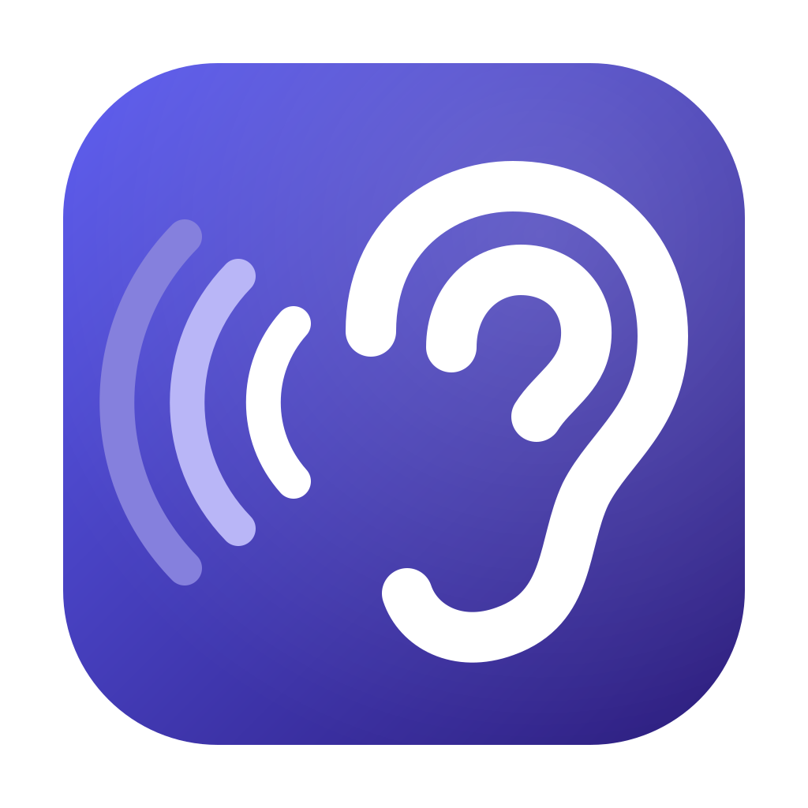
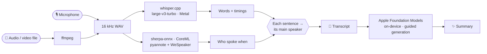

<div align="center">



# Earshot

**Private meeting notes that never leave your Mac.**

Record a meeting, get a transcript with speaker labels, and a summary in the format you need —<br>
all on-device, with no account, no cloud and no internet connection.


</div>

> [!IMPORTANT]
> **Nothing leaves this Mac.** Every model runs locally: Whisper for speech, a voice model for
> speakers, and Apple's on-device model for summaries. Turn off Wi-Fi and it all still works.
> Earshot never uses Apple's Private Cloud Compute.

---

## ✨ Features

| | |
|---|---|
| 🎙️ **Record** | One click to record from the microphone you choose, with a live level meter and timer. |
| 📂 **Import** | Drag in any audio or video file, or right-click it in Finder → **Open With → Earshot**. |
| 📝 **Transcribe** | Whisper large-v3-turbo on the GPU: about 45 seconds for a 14-minute call. Editable. |
| 🗣️ **Speakers** | Labels who spoke when. Click a speaker to rename them everywhere. |
| ✨ **Summarize** | Nine Plaud-style templates, from meeting minutes to sales calls, with action items. |
| ✏️ **Edit** | Fix the summary in a rich-text editor: headings, bold, bullets, checkboxes. Edited summaries are never replaced without asking. |
| 🌍 **Translate** | Turns speech in other languages into English text. |
| 🗂️ **Timeline** | Every recording by day, named by its summary or by you. |
| 🧭 **Menu bar** | The ear at the top of the screen: record without opening the window, see the timer, jump to recent recordings. |
| 📊 **Meter** | CPU, GPU and memory use, live in the header bar. |

## 🧭 How it works



Apple's model fills in typed fields (title, overview, sections, action items with owner and due
date), and Earshot writes the Markdown. A small model stays far more accurate this way than when
it writes free text.

## 🧾 Summary templates

| Template | Sections |
|---|---|
| 👥 **Meeting minutes** *(default)* | One per topic · Decisions · Open questions |
| 📄 Quick summary | Key points |
| 💼 Sales call | Customer · Situation · Pain points · Requirements · Objections · Competitors · Budget & timeline · Next steps |
| 🤝 One-on-one | Updates · Challenges · Feedback · Decisions |
| ✅ Daily stand-up | One per person: Done / Next / Blocked |
| 🎤 Interview | Background · One per theme · Notable quotes |
| 🎓 Lecture or class notes | One per concept · Examples · Questions to review |
| 💡 Brainstorm | One per idea group · Most promising · Next steps |
| 🌊 Voice memo | Main points · Ideas |

Every summary starts with the date, length and speakers, and ends with action items as checkboxes.

## ⌨️ Shortcuts

| Keys | Action |
|---|---|
| <kbd>⌘</kbd> <kbd>R</kbd> | Record / Stop |
| <kbd>⌘</kbd> <kbd>O</kbd> | Import a file |
| <kbd>⇧</kbd> <kbd>⌘</kbd> <kbd>C</kbd> | Copy the open tab |
| <kbd>⌘</kbd> <kbd>,</kbd> | Settings: microphone, speakers, default template |
| <kbd>⌘</kbd> <kbd>?</kbd> | How Earshot works |

## 🚀 Setup

<details>
<summary><b>1. Install the tools</b></summary>

```bash
brew install whisper-cpp ffmpeg uv
```

You also need Xcode (for `swiftc`), and macOS 26.4 or later with Apple Intelligence turned on.

</details>

<details>
<summary><b>2. Download the models</b> (not in git, ~2.5 GB)</summary>

Into `~/Models/whisper/`:

| File | Source |
|---|---|
| `ggml-large-v3-turbo.bin` | [ggerganov/whisper.cpp](https://huggingface.co/ggerganov/whisper.cpp) |
| `ggml-large-v3-q5_0.bin` | [ggerganov/whisper.cpp](https://huggingface.co/ggerganov/whisper.cpp) (translation) |
| `ggml-silero-v5.1.2.bin` | [ggml-org/whisper-vad](https://huggingface.co/ggml-org/whisper-vad) |

Into `~/Models/speakers/`, from [k2-fsa/sherpa-onnx releases](https://github.com/k2-fsa/sherpa-onnx/releases):

| File | Release |
|---|---|
| `sherpa-onnx-pyannote-segmentation-3-0.tar.bz2` (unpack it) | `speaker-segmentation-models` |
| `wespeaker_en_voxceleb_resnet34_LM.onnx` | `speaker-recongition-models` |

</details>

<details>
<summary><b>3. Build and install</b></summary>

```bash
bash EarshotApp/build.sh
```

This installs `Earshot.app` in `~/Applications` and the helper scripts in `~/.local/bin`.
The app icon is compiled from `assets/Earshot.icon` with Apple's `actool`, so macOS draws it
with Liquid Glass, as the [Human Interface Guidelines](https://developer.apple.com/design/human-interface-guidelines/app-icons) ask.
The app is ad-hoc signed, so it runs only on the Mac that built it. The first speaker
detection downloads `sherpa-onnx` from PyPI into uv's cache.

</details>

## 📁 Where things live

| What | Where |
|---|---|
| The app | `~/Applications/Earshot.app` |
| Recordings and results | `~/Recordings/whisper/` — per recording: audio, `.txt`, `.srt`, `.json`, `.summary.md`, `.name` |
| Helper scripts | `~/.local/bin/transcribe`, `~/.local/bin/speakers` |
| Models | `~/Models/whisper/`, `~/Models/speakers/` |
| Activity log | `~/Library/Logs/Earshot.log` — clicks, file names and results, never what was said |

## 💻 Command line

The scripts the app runs work on their own too:

```bash
transcribe meeting.m4a          # → meeting.txt, .srt, .json
transcribe -t interview.mp3     # translate to English
speakers meeting.m4a            # add speaker labels to meeting.txt
speakers meeting.m4a -n 3       # exactly 3 speakers
```

## 🔬 Accuracy notes

> [!TIP]
> If you know how many people were in a meeting, choose the number in the **Speakers** menu above
> the transcript. It is more accurate than detecting it.

- **Speaker detection** was tuned on a real 14-minute, 3-voice call: the library default found 9
  "speakers", and Earshot's setting (0.7) found the real ones. Two similar voices in a short clip
  can still merge, and fast back-and-forth inside one run-on sentence can land in the wrong turn.
- **Summaries** come from a small on-device model. It reads about 12 minutes of speech at once, so
  longer recordings are summarized in parts first. Check names and numbers before you share one.
- **Transcripts** can mishear names and jargon. Correct the Transcript tab, then click
  **Summarize** to rewrite the summary.
- **Summaries** can be corrected directly: click **Edit** above the summary. Earshot marks it
  as edited and asks before a new summary replaces it.

## 🗂️ Project layout

```
.
├── EarshotApp/
│   ├── Earshot.swift      the whole app: timeline, tabs, recording, speakers, summaries
│   ├── RichText.swift     the rich summary editor, and Markdown ↔ formatted text
│   ├── Info.plist         name, icon, microphone permission text, file types it opens
│   └── build.sh           builds and installs the app and the scripts
├── scripts/
│   ├── transcribe         whisper.cpp wrapper
│   └── speakers           speaker detection (Python, run by uv)
└── assets/
    ├── Earshot.icon/      the app icon: layered Icon Composer file (background + glass layers)
    ├── menubar.svg        the menu bar ear (a template image macOS tints)
    ├── earshot-logo.svg   the flat logo for this README
    └── badges/            the badges above, drawn locally
```

<div align="center">
<br>
<sub>Built on <a href="https://github.com/ggml-org/whisper.cpp">whisper.cpp</a>,
<a href="https://github.com/k2-fsa/sherpa-onnx">sherpa-onnx</a> and Apple's Foundation Models framework.<br>
Local repository · not published.</sub>
</div>
