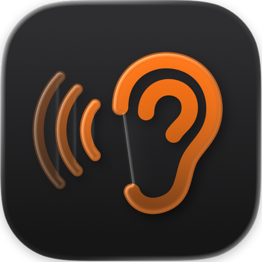
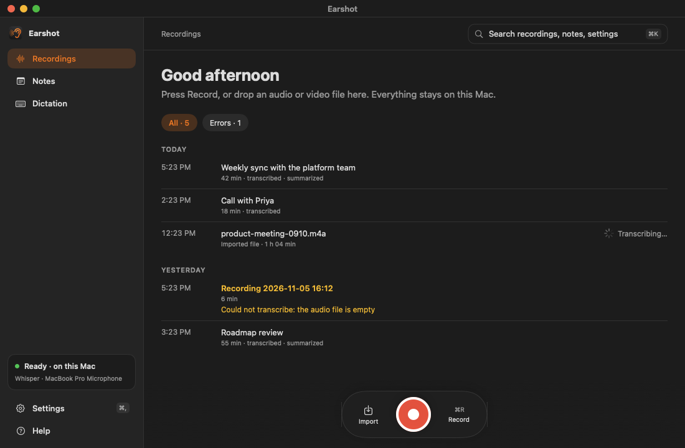
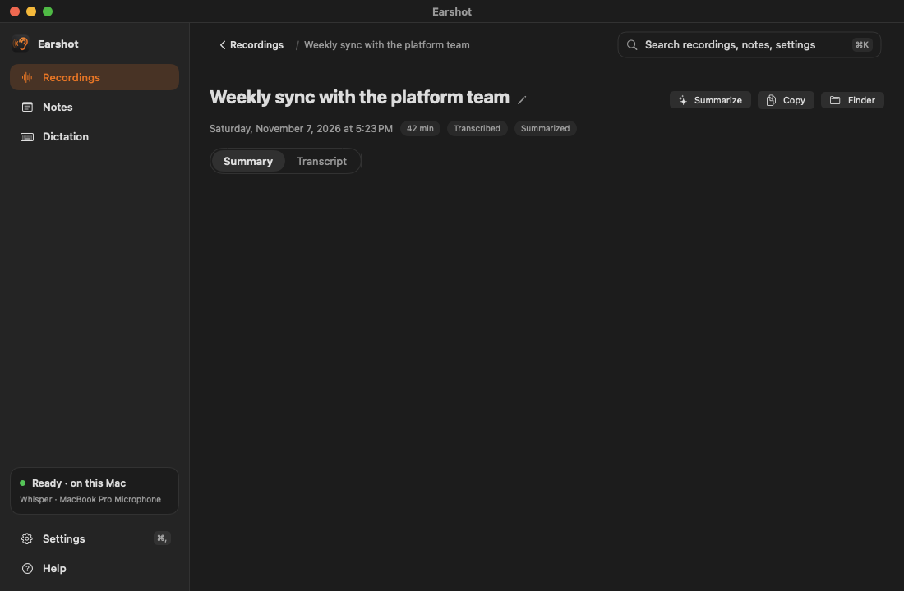
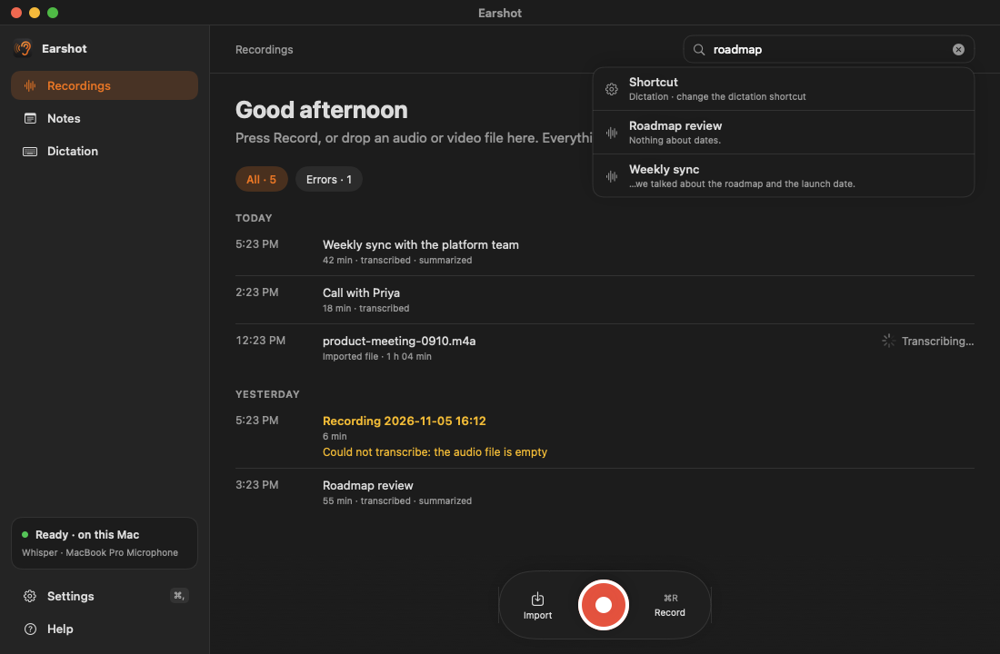
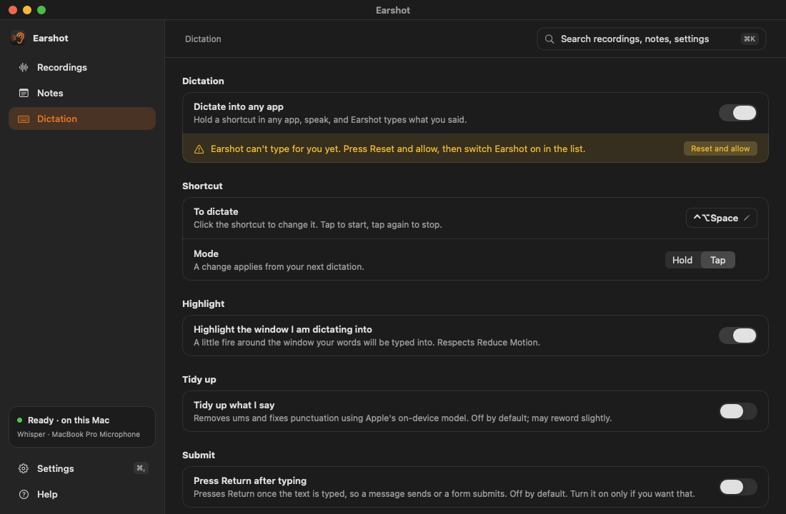
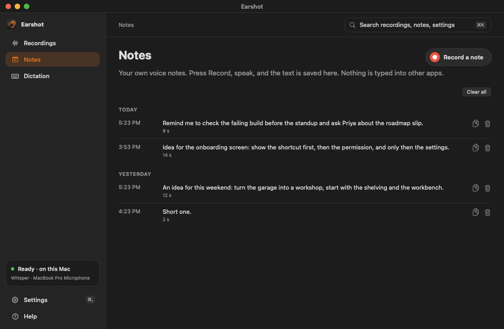

# Earshot

**Meeting notes and dictation that stay on your Mac.**

Earshot records your meetings, writes the transcript, labels who spoke and drafts the summary. Hold a shortcut in any app and it types what you say. Everything runs on your Mac.

[Download Earshot](https://github.com/gaberger/earshot/releases/latest) · [Install guide](docs/INSTALL.md) · [User guide](docs/GUIDE.md)

Requires a Mac with Apple silicon and macOS 26.4 or later.

## Meetings, written up

Record a call, or drop in any audio or video file. Whisper turns it into a transcript on your Mac, Earshot labels who spoke when, and a summary with action items is drafted from one of nine templates. Edit anything you like: Earshot never replaces a summary you changed without asking.

## Find anything

One search bar looks across your recordings, notes and settings, or press ⌘K from anywhere in the app. Recordings, Notes and Dictation are one click apart in the sidebar.

## Dictate into any app

Hold a shortcut, speak, and let go: Earshot types what you said where your cursor is. Fix the words it mishears, and optionally tidy up the ums. A fire outline shows which window it will type into. The details are in the [User guide](docs/GUIDE.md).

## Voice notes

Press record, say it, and get the text. Only the text is kept, so a note stays small and easy to search.

All screenshots show sample data and are renders of the real app views, not captures of anyone's recordings. The title bar is drawn, and the native toolbar, the bottom status bar and the dictation fire outline and pill are not in them.

## Private by design

Every model runs on your Mac: Whisper for speech, a voice model for speakers and Apple's on-device model for summaries. There is no account and no cloud. If you connect an AI agent, what you let it read goes to that agent, and you can read [exactly what that means](docs/PRIVACY.md).

## Works with your agents

A read-only MCP server lets an agent such as Claude Code read your transcripts and summaries. An optional hook speaks replies aloud. [Set up agents](docs/AGENTS.md).

## Get started

Download the disk image from the latest release, drag Earshot to Applications and open it. The app is not notarized by Apple, so macOS asks you to confirm the first time with Open Anyway in System Settings. The models download once. The steps are in the [install guide](docs/INSTALL.md).

## Documentation

- [Install guide](docs/INSTALL.md)
- [User guide](docs/GUIDE.md)
- [Privacy](docs/PRIVACY.md)
- [Agents](docs/AGENTS.md)
- [Development](docs/DEVELOPMENT.md)
- [Release notes](docs/releases)
- [Security policy](SECURITY.md)

Open source under the <a href="LICENSE">MIT License</a>. Built on <a href="https://github.com/ggml-org/whisper.cpp">whisper.cpp</a>, <a href="https://github.com/k2-fsa/sherpa-onnx">sherpa-onnx</a> and Apple Foundation Models.

