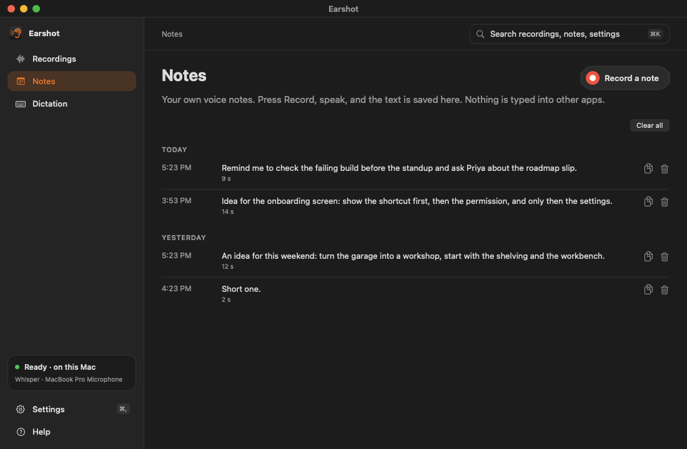
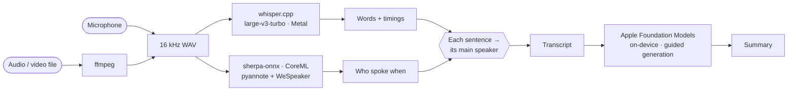

# Earshot user guide

Back to the [README](../README.md). Setup is in the [install guide](INSTALL.md).

## Features

- **Record.** One click to record from the microphone you choose, with a live level meter and timer. It stops by itself after a quiet spell, and warns you first.
- **Import.** Drag in any audio or video file, or right-click it in Finder → **Open With → Earshot**.
- **Transcribe.** Whisper large-v3-turbo on the GPU: about 45 seconds for a 14-minute call. Editable.
- **Speakers.** Labels who spoke when. Click a speaker to rename them everywhere.
- **Summarize.** Nine Plaud-style templates, from meeting minutes to sales calls, with action items.
- **Edit.** Fix the summary in a rich-text editor: headings, bold, bullets, checkboxes. Edited summaries are never replaced without asking.
- **Translate.** Turns speech in other languages into English text.
- **Dictate.** Hold a shortcut (<kbd>⌃</kbd> <kbd>⌥</kbd> <kbd>Space</kbd> unless you change it) in any app, speak, let go, and Earshot types what you said, into a form, an email, anywhere. A small **Listening…** indicator shows while it hears you. Off until you turn it on in Settings.
- **Categories.** The sidebar has three: **Recordings** (meetings and calls), **Notes** (your own voice notes) and **Dictation** (typing into any app).
- **Search.** Search across recordings, notes and settings from the search bar, or press <kbd>⌘</kbd> <kbd>K</kbd>.
- **Tidy up what I say.** Removes ums and stutters from dictated text using Apple's on-device model. Off until you switch it on.
- **Window outline.** A fire outline shows which window dictation will type into. On by default; it can be turned off in Settings.
- **Press Return after typing.** Presses Return once dictated text is typed, so a message sends. Off until you switch it on.
- **Agents.** A read-only MCP server lets an agent read your recordings, and a hook can speak Claude Code's replies aloud. Both are off until you set them up. See [Agents](AGENTS.md).
- **Timeline.** Every recording by day, named by its summary or by you.
- **Menu bar.** The ear at the top of the screen: record without opening the window, see the timer, jump to recent recordings.
- **Status bar.** What Earshot is doing now, plus live CPU, GPU and memory use, along the bottom of the window.

All screenshots in the [README](../README.md) show sample data and are renders of the real app views, not captures of anyone's recordings. The title bar is drawn, and the native toolbar, the bottom status bar and the dictation fire outline and pill are not in them.



## How it works



Apple's model fills in typed fields (title, overview, sections, action items with owner and due
date), and Earshot writes the Markdown. A small model stays far more accurate this way than when
it writes free text.

## Summary templates

| Template | Sections |
|---|---|
| **Meeting minutes** *(default)* | One per topic · Decisions · Open questions |
| Quick summary | Key points |
| Sales call | Customer · Situation · Pain points · Requirements · Objections · Competitors · Budget & timeline · Next steps |
| One-on-one | Updates · Challenges · Feedback · Decisions |
| Daily stand-up | One per person: Done / Next / Blocked |
| Interview | Background · One per theme · Notable quotes |
| Lecture or class notes | One per concept · Examples · Questions to review |
| Brainstorm | One per idea group · Most promising · Next steps |
| Voice memo | Main points · Ideas |

Every summary starts with the date, length and speakers, and ends with action items as checkboxes.

## Shortcuts

| Keys | Action |
|---|---|
| <kbd>⌘</kbd> <kbd>R</kbd> | Record / Stop |
| <kbd>⌘</kbd> <kbd>O</kbd> | Import a file |
| <kbd>⌘</kbd> <kbd>K</kbd> | Search recordings, notes and settings |
| <kbd>⇧</kbd> <kbd>⌘</kbd> <kbd>C</kbd> | Copy the open tab |
| <kbd>Esc</kbd> or <kbd>⌘</kbd> <kbd>[</kbd> | Go back from an open recording to the Recordings list |
| <kbd>⌘</kbd> <kbd>,</kbd> | Settings: microphone, speakers, default template |
| <kbd>⌘</kbd> <kbd>?</kbd> | How Earshot works |
| <kbd>⌃</kbd> <kbd>⌥</kbd> <kbd>Space</kbd> | Dictate: hold, speak, release (in any app, once turned on in Settings; you can change the keys) |

## Dictation

Turn on **Settings → Dictation → Dictate into any app**. Earshot asks for **Microphone** and
**Accessibility** access (System Settings → Privacy & Security); Accessibility is what lets it type
for you. Then click into any text field, hold <kbd>⌃</kbd> <kbd>⌥</kbd> <kbd>Space</kbd>, speak, and
let go. A second or two later the text appears where your cursor is.

- **Change the shortcut** under **Settings → Dictation → Shortcut**: click it and press the keys you
  want. It must include <kbd>⌃</kbd> or <kbd>⌥</kbd> (or be a function key such as <kbd>F5</kbd>), so it
  never steals ordinary typing, and shortcuts macOS already owns can't be chosen. **Reset** brings back
  the default. If another app already uses your choice, Earshot says so.
- **Hold, or tap.** By default you hold the keys while you talk. Under **Settings → Dictation → Mode**
  you can switch to **Tap to start, tap to stop**, which is easier for long dictations. A change
  applies from your next dictation.
- **Fix words it mishears** under **Settings → Dictation → Corrections**: one per line, as
  `ear shot => Earshot`. Matching ignores case and only hits whole words, and the longest phrase wins.
- **Tidy up what I say** under **Settings → Dictation → Tidy up** (off by default) removes ums and stutters and fixes punctuation using Apple's on-device model. It may reword slightly; if the model is unavailable, slow or drifts from what you said, your words are typed as spoken.
- **The indicator.** While you hold the keys a small **Listening…** pill with a live level bar floats
  near the bottom of the screen you're on, so you can see the microphone is hearing you. It switches
  to **Transcribing…** after you let go, then disappears as the text arrives. It never takes focus
  from the field you're typing into.
- **The window outline.** While you dictate, a little fire licks around the edge of the window your
  words will be typed into (low embers while it transcribes), so you can see where they will land. Earshot
  reads only that window's position and size, never its title or contents. With **Reduce Motion** on you
  get a plain static border instead. Turn it off under **Settings → Dictation → Highlight the window I am
  dictating into**.

- **Press Return after typing** under **Settings → Dictation → Submit** (off by default) presses Return once the text is typed, so a message sends or a form submits. It does not press Return when there is no text, when the text was left on the clipboard because Earshot can't type yet, or when a secure input field is active.
- It transcribes on this Mac with the same Whisper model as recordings. The audio is deleted at once. The one exception is a clip that could not be transcribed: it stays in a private temporary file until your next dictation, so **Retry last dictation** in the menu bar can try it again.
- **It does not type into the wrong window.** Earshot remembers which window and which field you started dictating in. If you switch to another window, app, tab or pane before the text is ready, it does not paste there (and it does not press Return there either): the text is put on the clipboard and a notice says so, so you can press ⌘V where you want it. This relies on macOS Accessibility. In an app that does not describe its windows to Accessibility (some Electron apps), Earshot cannot tell and pastes as before. The text stays on the clipboard until you copy something else, and a clipboard-history tool may record it.
- **Dictation keeps nothing.** What you say is typed into the app in front and that is all: no text and no audio is saved. The exceptions are the ones named above: one failed clip kept in a private temporary file until your next dictation, and the clipboard when Earshot is not allowed to type or you switched windows.


## Notes: your own voice notes

**Notes** is a separate area, with its own **Record a note** button. Press it, speak, press **Stop**, and the note is transcribed on this Mac and saved in the Notes list, grouped by day, with Copy and Delete on each. Nothing is typed into other apps. Only the text is kept, in `~/Library/Application Support/Earshot/notes.json`; the audio is deleted at once. Corrections from **Dictation** apply to notes too. A note cannot start while a meeting is being recorded or while you are dictating. **Clear all** deletes every note.

Earshot now has three separate functions: **Recordings** (meetings and calls), **Notes** (voice notes you record in Earshot) and **Dictation** (typing into any app).
- The microphone is open only while you hold the keys. A tap shorter than a third of a second does
  nothing, and a hold stops by itself after a minute.
- It types by pasting, then puts back whatever was on your clipboard.
- It won't type into password fields, and it's off while a meeting is being recorded.
- The app isn't notarized, so macOS may forget the Accessibility permission after an update. If
  Dictation stops typing, switch Earshot off and on again in the Accessibility list.


## Command line

The scripts the app runs work on their own too:

```bash
transcribe meeting.m4a          # → meeting.txt, .srt, .json
transcribe -t interview.mp3     # translate to English
speakers meeting.m4a            # add speaker labels to meeting.txt
speakers meeting.m4a -n 3       # exactly 3 speakers
```

## Accuracy notes

> [!TIP]
> If you know how many people were in a meeting, choose the number in the **Speakers** menu above
> the transcript. It is more accurate than detecting it.

- **Speaker detection** was tuned on a real 14-minute, 3-voice call: the library default found 9
  "speakers", and Earshot's setting (0.7) found the real ones. Two similar voices in a short clip
  can still merge, and fast back-and-forth inside one run-on sentence can land in the wrong turn.
- **Summaries** come from a small on-device model. It reads about 12 minutes of speech at once, so
  longer recordings are summarized in parts first. Check names and numbers before you share one.
- **Transcripts** can mishear names and jargon. Correct the Transcript tab, then click
  **Summarize** to rewrite the summary.
- **Summaries** can be corrected directly: click **Edit** above the summary. Earshot marks it
  as edited and asks before a new summary replaces it.
